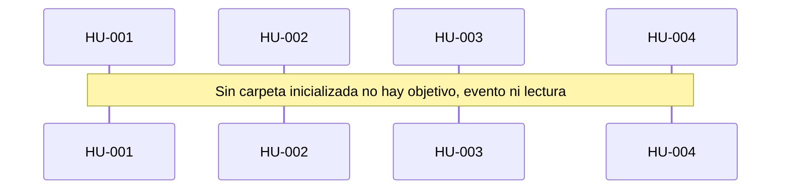

# Runbook 001 — Ventana

## Objetivo

Una ventana que abre una carpeta, la inicializa o la carga, guarda un objetivo, publica un descubrimiento significativo y puede listar, buscar y leer sin convertir esa lectura en un evento.

## HUs (fuente del qué)

- [HU-001](../../05-backlog/01-workspace/E-001-problema/F-001-carpeta/HU-001-abrir-carpeta.md)
- [HU-002](../../05-backlog/01-workspace/E-001-problema/F-001-carpeta/HU-002-objetivo.md)
- [HU-003](../../05-backlog/01-workspace/E-001-problema/F-002-tablero/HU-003-descubrimiento.md)
- [HU-004](../../05-backlog/01-workspace/E-001-problema/F-003-lectura/HU-004-leer-carpeta.md)

HU-005…HU-008 están en el backlog y no entran en este corte.

## Negocio (secuencia)

## Pasos

| # | Tipo | Qué | Insumos | Status | % |
| --- | --- | --- | --- | --- | --- |
| 1 | analyze | HUs del corte y secuencia | product.md + HUs | `done` | 100 |
| 2 | compose | Spec de la ventana | HU-001…004 + arch + pantalla | `done` | 100 |
| 3 | implement | Ejecutar esa spec | spec 001-ventana | `done` | 100 |

## Estado actual

- Paso corriente: ninguno. El corte está `ai-tested`.
- Siguiente: runbook de HU-005…HU-008 (editar, enjambre, reanudar, MCP)
- Bloqueos: ninguno

`progress` = pasos `done` / 3.
