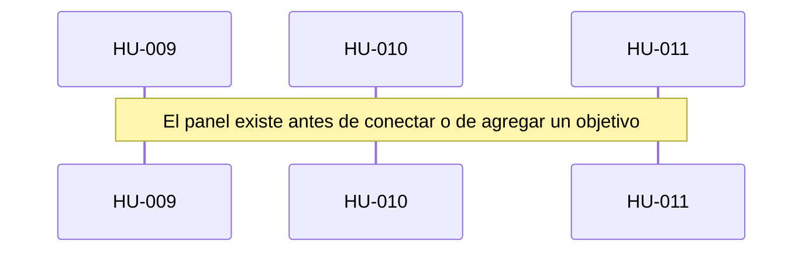

# Runbook 002 — Panel

## Objetivo

La extensión muestra el panel en la carpeta abierta, elige dos modelos que VS Code ya tiene y guarda el árbol de objetivos.

## HUs (fuente del qué)

- [HU-009](../../05-backlog/01-workspace/E-001-problema/F-005-panel/HU-009-panel.md)
- [HU-010](../../05-backlog/01-workspace/E-001-problema/F-005-panel/HU-010-conexion.md)
- [HU-011](../../05-backlog/01-workspace/E-001-problema/F-005-panel/HU-011-asistente.md)

## Negocio (secuencia)

## Pasos

| # | Tipo | Qué | Insumos | Status | % |
| --- | --- | --- | --- | --- | --- |
| 1 | analyze | HUs del panel | product.md + pantallas | `done` | 100 |
| 2 | compose | Spec del panel | HU-009…011 | `done` | 100 |
| 3 | implement | Extensión | spec 002-panel | `done` | 100 |

## Estado actual

- Paso corriente: ninguno. El corte está `ai-tested`.
- Siguiente: HU-006, arrancar el nodo
- Bloqueos: ninguno
